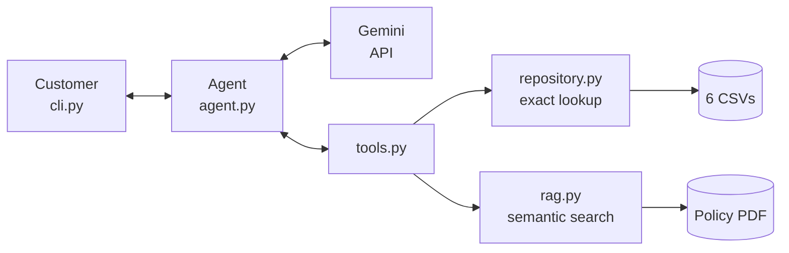

# Téo — virtual assistant for Empório da Música

Prototype of a text-message customer-service agent for Empório da Música, a musical-instrument store in
Campo Grande, MS (Brazil). The agent (**Téo**) answers questions about the catalog, prices, promotions, orders
and store policies. It talks to customers in Brazilian Portuguese, in an informal but professional tone.

- **Language:** Python
- **Approach:** hybrid — *function calling* for structured data (CSVs) + **RAG** for the policies (PDF)
- **Model:** Gemini (free API tier), configurable
- **Interface:** CLI, with persisted conversation history

## Contents

1. [Setup and usage](#1-setup-and-usage)
2. [How the agent works](#2-how-the-agent-works)
3. [Decision: agent approach (why RAG)](#3-decision-agent-approach-why-rag)
4. [Other technical decisions](#4-other-technical-decisions)
5. [Assumptions about the policy manual](#5-assumptions-about-the-policy-manual)
6. [Data handling](#6-data-handling)
7. [Example conversations](#7-example-conversations)
8. [Limitations and next steps](#8-limitations-and-next-steps)
9. [Use of AI coding assistants](#9-use-of-ai-coding-assistants)
10. [Repository structure](#10-repository-structure)

---

## 1. Setup and usage

### Prerequisites

- Python 3.10 or newer (tested on 3.13).
- A Gemini API key, free and no credit card required: <https://aistudio.google.com/apikey>.

### Installation

Linux / macOS:

```bash
python -m venv .venv
source .venv/bin/activate
pip install -r requirements.txt
cp .env.example .env
```

Windows (PowerShell):

```powershell
python -m venv .venv
.venv\Scripts\activate
pip install -r requirements.txt
copy .env.example .env
```

Open `.env` and fill in the key:

```
GEMINI_API_KEY=your_key_here
```

> Mind the `-r` in `pip install -r requirements.txt`. Without it, pip tries to install a package called
> "requirements.txt" and fails with `No matching distribution found`.

### Data

The `data/` folder already contains the challenge's 6 CSVs and `políticas_da_loja.pdf`:

```
data/
  desafio_tecnico_ai_eng - products.csv      desafio_tecnico_ai_eng - orders.csv
  desafio_tecnico_ai_eng - categories.csv    desafio_tecnico_ai_eng - order_items.csv
  desafio_tecnico_ai_eng - customers.csv     desafio_tecnico_ai_eng - promotions.csv
  políticas_da_loja.pdf
```

Files are recognized by name (`product`/`produto`, `customer`/`cliente`, `order`/`pedido`, `item`, `categor`,
`promo`), and columns may be in English or Portuguese. Only the products table is mandatory. To use another
folder, set `EMPORIO_DATA_DIR` in `.env`.

### Running the agent

```bash
python main.py            # new conversation
python main.py -v         # shows the tools the agent called on each turn
```

On the first question about store rules, the agent generates the policy embeddings (one API call) and caches
them in `.cache/`; later runs reuse the cache.

**In-chat commands**

| Command | What it does |
|---|---|
| `/novo` | Starts a new conversation (new session) |
| `/exportar [name]` | Saves the conversation to `examples/<name>.md` and `examples/<name>.txt`, including the tools called on each turn |
| `/sair` | Ends and saves the conversation (Ctrl+C also works) |

**Command-line options**

| Option | What it does |
|---|---|
| `-v`, `--verbose` | Shows the tools called, e.g. `[tool consultar_politicas({'pergunta': '...'})]` |
| `--sessao <id>` | Resumes a conversation saved in `sessions/<id>.json` (the id is printed on exit). Each session also writes `sessions/<id>.txt` as plain text |
| `--checar-dados` | Lists inconsistencies in the CSVs and exits, without using the API |

### Environment variables (`.env`)

| Variable | Default | Purpose |
|---|---|---|
| `GEMINI_API_KEY` | (required) | API key |
| `GEMINI_MODEL` | `gemini-2.5-flash` | Chat model. Free-tier models change over time; check Google's documentation |
| `GEMINI_EMBEDDING_MODEL` | `gemini-embedding-001` | Embedding model for the policies |
| `EMPORIO_DATA_DIR` | `./data` | Folder with the CSVs and the PDF |
| `EMPORIO_HOJE` | (real date) | Fixes "today's date", format `YYYY-MM-DD` |

`EMPORIO_HOJE` exists to reproduce examples: the orders in the dataset range from 2025-10-15 to 2026-03-22, so
with the real date no delivered order is inside the 7-day withdrawal window. With `EMPORIO_HOJE=2026-02-20`,
order 7 is inside the window. In PowerShell: `$env:EMPORIO_HOJE="2026-02-20"; python main.py -v`.
Leave it unset for normal use.

### Tests

```bash
pytest
```

69 tests, which **do not call the API** (they use a fake Gemini client and a fake embedder). They cover data
cleaning, the tools, the agent loop, chunking, the RAG cache and fallback, and the challenge's 6 real CSVs.

### Troubleshooting

| Symptom | Cause and fix |
|---|---|
| `Defina GEMINI_API_KEY no arquivo .env` | `.env` is missing or has no key |
| `Nenhum CSV de produtos encontrado em ...` | The products file name does not contain `produto` or `product`, or the folder is empty. The message lists the CSVs it found |
| `não encontrei a coluna 'x'` | The CSV uses a different column name. Add it to `ALIASES` (`src/emporio/data_loader.py`); the message lists the file's columns |
| `429` error / "Opa, tive um problema aqui do meu lado" | Free-tier quota. The agent retries up to 3 times with backoff; if it persists, wait a few minutes |
| `ImportError: DLL load failed ... Controle de Aplicativo` (Windows) | A Windows policy blocked a pandas file installed outside a virtual environment. Reinstall inside a `.venv` with `pip install --no-cache-dir -r requirements.txt` |

---

## 2. How the agent works



On every message, `agent.py` sends Gemini the system prompt, the history and the list of tools. The model
replies with either a final answer or a tool request. The tool is executed by the project's code, never by the
model; the result goes back to the model, which can request another tool (up to 6 steps) or write the answer.
The model only sees what the tools return, never the full CSVs or the full PDF.

| Tool | Purpose | Source |
|---|---|---|
| `buscar_produtos` | Price, current promotion, stock; filters by category, brand and price range | CSVs |
| `listar_promocoes_ativas` | Promotions valid today | CSVs |
| `consultar_pedido` | Status, items, payment and tracking (requires the order number **and** the e-mail on file) | CSVs |
| `simular_pagamento` | PIX, debit, boleto and installments, with the math done in code | CSVs + payment rules |
| `consultar_politicas` | Exchanges, returns, warranty, shipping, payment, opening hours, privacy, store details | **RAG** over the PDF |
| `encaminhar_para_equipe` | Complaints, warranty and cases the agent cannot resolve: issues a ticket number and a response deadline | `sessions/encaminhamentos.jsonl` |

### The RAG pipeline

1. **Extraction:** `pypdf` in *layout* mode (the default mode returns one word per line for this PDF), removing
   headers and page numbers and keeping tables readable.
2. **Section-aware chunking:** the manual is split along its own numbered sections (1, 1.1, 4.2...), giving 26
   chunks. The indexed text of each chunk includes its parent section title ("Exchange and Return Policy > Exchanges for Defects").
3. **Embeddings:** `gemini-embedding-001`, with task type `RETRIEVAL_DOCUMENT` for chunks and `RETRIEVAL_QUERY` for
   the question. Chunk vectors are computed once and cached in `.cache/` (the cache key is a hash of the
   content, so replacing the PDF re-indexes automatically).
4. **Search:** vectors are L2-normalized (length 1), so the dot product between the chunk matrix and the query
   vector (`vetores @ q`, in numpy) **is** the cosine similarity. The 4 highest-scoring chunks go back to the
   model with their section label (e.g. `4.1 Direito de Arrependimento`).
5. **Fallback:** if the embeddings API fails (quota, network), search falls back to a lexical ranking
   (simplified BM25) and the conversation continues.

---

## 3. Decision: agent approach (why RAG)

> Decision requested in the brief: *"Framework(s) / agent approach: RAG, function calling, ReAct, SQL agent, hybrid, etc."*

### The choice

**Hybrid approach:** Gemini's native *function calling*, with **RAG exposed as one of the tools**
(`consultar_politicas`). Structured data (products, orders, promotions) is queried by exact-lookup tools;
free text (policies) is queried through RAG. I use no agent framework: the loop is a little over 100 lines
(`agent.py`).

The brief asks the agent to know *"when to look up data and when to look up policies"*. Each source has a
different nature, and the approach follows that:

| Question type | Nature of the answer | Mechanism |
|---|---|---|
| "Guitars under R$ 1000?", "How much is the Takamine GD20?", "Where is my order?" | **Exact** value, with numeric filter, key and verification | Lookup tools (`repository.py`) |
| "Can I return it?", "How long is the warranty?", "How many installments?" | Rule in **free text**, which the customer phrases in other words | **RAG** (`consultar_politicas`) |

### Why RAG for the policies

1. **Routing is explicit and auditable.** Because the policy lookup is a tool, every rule question shows up in the
   log (`-v`) and in exported conversations as `consultar_politicas(...)`, with the retrieved sections. You can
   see *when* the agent went to the policies and *what* it based its answer on, which is exactly what the brief
   asks to demonstrate. With the policies pasted into the prompt, that decision is invisible.
2. **Answers are traceable to a section.** Every chunk comes back with its number (4.1, 3.1, 8.1...). A wrong
   answer can be diagnosed: either retrieval fetched the wrong chunk, or the model misread the right one.
3. **It does not break when the manual grows.** The manual is a living document (version 2.1; section 10 says it is
   *"subject to periodic updates"*). Today it fits in the model's context; a manual with per-manufacturer
   warranties, per-campaign rules and appendices would not, and the prompt would fill up with rules that are
   irrelevant to most questions. With RAG, swapping the PDF is enough: chunking and re-indexing are automatic.
4. **Per-turn cost proportional to what was asked.** Most of the service (price, stock, orders) does not need the
   manual. With RAG, only a rule question pays for the manual, and only for part of it: at most about 2.9k
   characters (the 4 largest chunks) versus the roughly 11k of the whole manual on every call.
5. **Lean system prompt.** Persona, tone, scope and the decisions about manual contradictions do not compete with
   eleven thousand characters of rules. This is a quality hypothesis that I **did not measure**.

### Why *not* RAG for the data

Embeddings measure **similarity**, not equality or order. "Guitars under R$ 1000" is a numeric filter, which
similarity search does not do (R$ 999 and R$ 1,299 are nearly identical to an embedding), and the query would
return the "most similar" items even when nothing fits. "Takamine GD20" could also bring back the GC5CE or the
GN51CE: quoting the price of a similar model is a serious error. An order lookup needs an exact key plus identity
verification, and PIX needs arithmetic. That is why these lookups are deterministic tools, and the agent never
receives a price that did not come from them.

### Alternatives considered

| Alternative | Why it was not chosen |
|---|---|
| **Function calling without RAG** (whole manual in the prompt) | The strongest alternative *for this manual*: 8 pages fit in context and there is no risk of retrieval missing a rule. I prototyped this variant with the same code, changing only how policies are accessed. I did not adopt it because of points 1 to 3 above (visible routing, traceability, scale). **I did not measure which answers better.** |
| **ReAct** (prompt that teaches a Thought/Action/Observation cycle and parses the text) | Native *function calling* already does the same cycle (the model decides, acts and observes the result), with typed arguments validated by the SDK and no fragile text parsing. |
| **SQL agent** (the model writes SQL) | The database is small (6 tables). Model-written SQL risks wrong joins, unrestricted reads of the customers table, and carries no business rules (valid promotion, PIX that does not stack, e-mail verification). Fixed tools encapsulate those rules. If the data grows, a SQLite database behind `repository.py` is the path. |
| **RAG over the CSVs** | Similarity does not filter by price or confirm stock (see above). |
| **LangChain / LlamaIndex / LangGraph** | They add dependencies and abstractions that hide what is sent to the model. For an agent with one loop and six tools, direct code is shorter, easier to test with a fake client and more transparent to review. |
| **Vector database (Chroma, FAISS...)** | There are 26 vectors. A numpy matrix with a dot product is exact and simple; a database would add complexity with no gain. |
| **Dify / no-code platforms** | The mandatory constraint is Python as the main language, and running the project would require spinning up extra services, which hurts reproducibility. |

### Costs and risks accepted (and how I mitigate them)

RAG carries a risk that full context does not: **retrieval may not bring back the right section**. It also costs
more calls per rule question (one embedding call and one extra tool round-trip), which weighs on the free-tier
quota. Mitigations in the project:

- **Structure-based chunking** instead of fixed-size chunks: each rule arrives whole, with its conditions and exceptions.
- **Parent-section context** in the indexed text, so that "Exchanges for Defects" is found as part of
  "Exchanges and Returns".
- **Top-4**, not top-1: many answers depend on two chunks (the payment table in section 3 and the installment
  tiers in 3.1).
- **The prompt tells the model to query more than once** when a question spans more than one topic (return and
  return shipping).
- **Prompt decisions override retrieved text.** Where the manual contradicts itself (phone number, warranty,
  installments; see [section 5](#5-assumptions-about-the-policy-manual)), the decision lives in the prompt and
  beats any chunk retrieval returns, so retrieval does not reintroduce the contradiction.
- **Lexical fallback** if the embeddings API fails.
- If no chunk answers the question, the agent says it does not have the information and offers to forward the
  case to the team, instead of guessing.

**What was not measured:** retrieval recall with real embeddings (question → expected section) and the quality
comparison between full context and RAG. The tests cover chunking, the cache and the lexical fallback (6 typical
questions retrieve the expected section). A retrieval evaluator is the first item under
[next steps](#8-limitations-and-next-steps).

---

## 4. Other technical decisions

| Decision | Choice | Why |
|---|---|---|
| Model and provider | **Gemini 2.5 Flash**, Google AI Studio free API | Free and no card needed, good Portuguese, with *function calling* and embeddings under the same key. Configurable via `GEMINI_MODEL`. |
| Interface | **CLI** | The focus is the agent. To run: `pip install` and `python main.py`. |
| History | One JSON per session in `sessions/`, resumable (`--sessao`) | Customer service is a conversation: the customer comes back and continues. I store only the turn text; tools are queried again on resume, because stock and promotions change. |
| Data | **pandas** with a cleaning layer | See [section 6](#6-data-handling). |
| Agent loop | Manual (not the SDK's automatic one) | Records which tool was chosen on each turn, which feeds `-v` and the examples. |
| Calculations | In code (`Decimal`) | LLMs get arithmetic wrong, and PIX, installments and deadlines decide what the customer pays or whether they can return an item. Trade-off: installment tiers are duplicated in the code and in the manual. |

**Prompt strategy.** Persona "Téo" (informal and professional, short messages, at most one emoji); a golden rule
of never inventing price, stock, promotion, deadline or order status; scope (instruments only; accessories and
off-topic subjects are declined kindly, without inventing partner stores); privacy (orders only with order
number and the e-mail on file); handling of out-of-stock, discontinued and "coming soon" products; and the
decisions about the manual's contradictions. The current date and time in Campo Grande are injected on every turn.

**Security.** `consultar_pedido` requires the number and the e-mail, and returns the same message whether the
order does not exist or the e-mail does not match, so it does not reveal whether an order exists.

---


## 7. Example conversations

The `examples/` folder holds conversations exported with `/exportar`. `examples/ROTEIRO.md` lists the suggested
questions and the values expected on the challenge data:

| File | Scenario |
|---|---|
| `01_catalogo_violoes.md` | "Which guitars do you have available up to R$ 1000?" (catalog) |
| `02_endereco_horario.md` | "What is the store's address?" (general information, via RAG) |
| `03_preco_takamine.md` | "How much is the Takamine GD20?" and installments (price and payment) |
| `04_arrependimento.md` | "I regret my purchase, can I return it?" (**non-trivial case**: live order data + policy rule) |
| `05_fora_do_escopo.md` | Request for an accessory and a subject unrelated to the store |

The agent's replies in these files are in Portuguese, since that is the customers' language.

---

## 8. Limitations and next steps

**Known limitations**

- **Model behavior needs to be checked against the real API.** The loop was tested with a fake client and the tool
  schemas were validated with the SDK, but tone, tool selection and rule compliance depend on Gemini.
  `examples/ROTEIRO.md` is the script for that check.
- **RAG:** quality depends on retrieval bringing back the right section. I did not measure recall with real
  embeddings. Without embedding quota, the lexical fallback is less precise when the customer uses vocabulary
  different from the manual's.
- Each rule question uses more requests than a catalog question (embedding plus a tool round-trip), which weighs
  on the free quota.
- No shopping cart: `simular_pagamento` handles one product at a time.
- The manual does not list the cities of Campo Grande's metropolitan area; when in doubt, the agent forwards the case.
- Forwarding to the team only writes a local file (it simulates integration with a ticketing system).
- There is no automatic customer identification (e.g. by WhatsApp number); the e-mail is requested in the conversation.
- No protection against *prompt injection* beyond the prompt rules and the e-mail verification.
- Data is read from the CSVs at startup, with no real-time refresh.
- Gemini's free tier may use submitted content to improve Google products. For real customer data, the paid tier
  or a local model would be required.

**What I would do with more time**

1. **Retrieval evaluator:** a set of questions with the expected section, measuring RAG recall with real embeddings.
2. **RAG × full-context comparison** on the same conversations, measuring accuracy and cost, to back (or refute)
   the decision with data.
3. An output guardrail that checks that every price quoted came from a tool.
4. Semantic search over product descriptions too ("a guitar for beginners"), keeping price, stock and orders as
   exact lookups.
5. Real WhatsApp and ticketing integration; SQLite instead of CSVs; streaming; observability.

---

## 9. Use of AI coding assistants

> **Review this section** so that it reflects exactly how you used the tools.

I used **Claude** (Claude Code) as a pair programmer. I discussed the architecture alternatives with it (RAG ×
full context × Dify × SQL agent), went through the brief and the manual to list the contradictions, and it
generated the initial code and test structure. The product decisions were mine, and I reviewed every change with
`git diff` before committing. The tests caught real problems, among them pandas swapping month and day in ISO
dates, a one-cent difference in promotional prices (floating-point rounding) and a `coming_soon` product showing
as available; each has a regression test.

---

## 10. Repository structure

```
main.py                  entry point
requirements.txt
.env.example
data/                    CSVs and policy PDF
examples/                exported conversations and ROTEIRO.md
sessions/                conversation history and forwarded cases (created at runtime)
src/emporio/
  config.py              environment variables and Campo Grande timezone
  data_loader.py         CSV reading and cleaning
  qualidade.py           inconsistency check (--checar-dados)
  repository.py          business queries: products, promotions, orders
  tools.py               tools exposed to the model
  policies.py            PDF to text
  rag.py                 section chunking, embeddings, search and lexical fallback
  prompts.py             persona, rules and decisions
  agent.py               function-calling loop with Gemini
  session.py             persistence and Markdown/text export
  cli.py                 command-line interface
tests/                   pytest, with a fake Gemini client and fixtures
```
